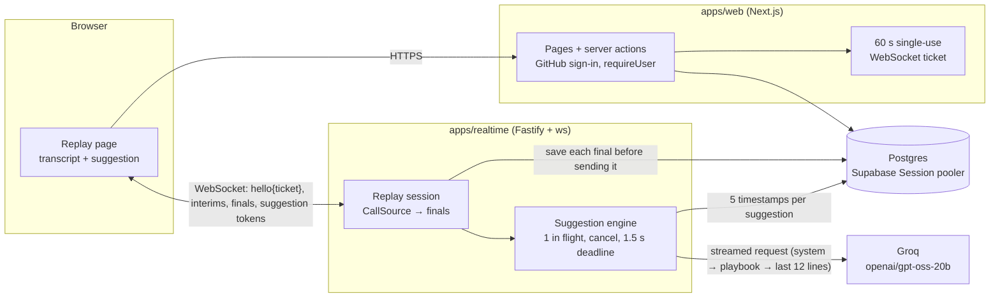

# Cue

**Cue is a real-time coach for sales calls.** While a rep talks to a prospect, Cue transcribes both sides and, the moment the prospect stops speaking, streams **one short line the rep could say next**, aiming for the first words on screen in under a second. Every suggestion records five timestamps from "the prospect stopped talking" to "painted in the rep's browser", so latency is measured per stage rather than guessed. Quality is measured too, by an offline eval harness with deterministic checks and an LLM judge. Today Cue replays real recorded calls as if they were live; live speech-to-text is the next step.

> **Status:** replay-based. Calls come from public datasets and are played back on their original timeline, so the latency numbers below **exclude speech-to-text** ([docs/latency.md](docs/latency.md)).

## Screenshots

- [ ] `docs/media/library.png`: the call library, with dataset, duration and audio filters
- [ ] `docs/media/latency.png`: the `/latency` page (p50/p95 for each stage)
- [ ] `docs/media/eval.png`: a `pnpm eval` report in the terminal

## Architecture



| Path               | What it is                                                                             |
| ------------------ | -------------------------------------------------------------------------------------- |
| `apps/web`         | Next.js (App Router) + Tailwind: landing page, sign-in, call library, replay, latency  |
| `apps/realtime`    | Node 20, Fastify + `ws`: replay sessions, suggestion engine, WebSocket protocol        |
| `packages/db`      | Drizzle ORM + Postgres: schema, migrations, ownership-scoped repositories              |
| `packages/shared`  | zod schemas shared by everything (protocol, timings, tickets)                          |
| `packages/suggest` | The versioned prompt, Groq streaming client and model settings (shared with the evals) |
| `packages/evals`   | Offline quality evals: cases, deterministic checks, LLM judge, compare                 |
| `packages/ingest`  | Imports public Hugging Face datasets into the recording library                        |

## Latency budget

The goal is the **first words of a suggestion on screen in under a second** after the prospect stops talking. A suggestion whose first token takes longer than **1.5 s** is dropped, because a late line is worse than none.

Measured numbers come from the app's `/latency` page: p50/p95 over my own replays, seeded demo rows excluded, with the sample count shown.

| Stage                         | From → to                                             | p50             | p95             |
| ----------------------------- | ----------------------------------------------------- | --------------- | --------------- |
| STT endpointing               | prospect stops speaking → transcriber emits the final | ‹not built yet› | ‹not built yet› |
| Cue pipeline                  | `utterance_end` → `suggestion_request_sent`           | 6 ms            | 13 ms           |
| Network + time to first token | `suggestion_request_sent` → `first_token`             | 320 ms          | 599 ms          |
| Rest of the line              | `first_token` → `last_token`                          | 22 ms           | 30 ms           |
| Delivery + render             | `last_token` → `rendered_in_client`                   | 28 ms           | 37 ms           |
| **Line ended → first token**  | `utterance_end` → `first_token`                       | **325 ms**      | **671 ms**      |
| **End to end**                | `utterance_end` → `rendered_in_client`                | **379 ms**      | **909 ms**      |

**Samples:** 185 suggestions with all five timestamps, out of 190 requested.

- 0 were dropped or cancelled.
- 5 were incomplete (still streaming, or never reported as painted).
- 6 short prospect replies were skipped by design.

**Setup:** measured on the **deployed** app (Vercel + Render + Supabase, free tiers), from my replays of gwenshap and saas calls at 1×. Model `openai/gpt-oss-20b` on Groq, prompt `suggest-v2/no-playbook`. Taken from `/latency` on 2026-11-24.

**What the numbers say:**

- **Both totals are inside budget.** p95 to the first token is 671 ms, well under the 1 s goal, and p95 end to end is 909 ms.
- **The model dominates.** Time to first token is about 85% of the end-to-end p50.
- **There are slow outliers.** The worst delivery + render was 10.3 s, which pulls the end-to-end max to 10.7 s while p95 stays at 37 ms. That pattern matches a background tab: browsers throttle the frame callbacks that report "painted". The worst first token was 1,148 ms, under the 1.5 s drop deadline.

**How to read it:**

- **STT endpointing isn't built yet.** In replay, `utterance_end` is when the transcript line is emitted. Real speech-to-text will add its endpointing delay in front of every other stage.
- **Network isn't a separate column, because it can't be measured separately.**
  - Server → Groq is inside "time to first token".
  - Server → browser is inside "delivery + render".
- **`rendered_in_client` can't be thrown off by clock skew.** It's the server's send time plus a duration the browser measured on its own clock, never a browser wall-clock time ([docs/latency.md](docs/latency.md)).
- **The prompt affects latency.** `suggest-v2` asks the model to count its words before answering. That costs hidden reasoning tokens, about +94 ms p50 and +200 ms p95 to the first token in the eval harness.

## Eval results

`pnpm eval` replays 43 real moments (price objections, "send me an email", competitors, …) through the exact prompt and settings production uses. Each line is scored with:

- **deterministic checks:** at most 20 words, one line, no preamble;
- **an LLM judge:** a different model, grading against a per-case rubric.

| Prompt                      | Pass rate      | Mean score (1–5) | Lines over 20 words | First token p50 / p95 (model time) | Cost / 1,000 |
| --------------------------- | -------------- | ---------------- | ------------------- | ---------------------------------- | ------------ |
| suggest-v1                  | 43.4% (56/129) | 3.71             | 29/129 (max 43)     | 314 / 499 ms                       | $0.0674      |
| suggest-v2 (**production**) | 62.0% (80/129) | 4.05             | 4/129 (max 22)      | 408 / 699 ms                       | $0.1070      |

**Setup:** 43 cases × 3 runs, every line graded. Model under test `openai/gpt-oss-20b`; judge `openai/gpt-oss-120b` (judge-v1). Run 2026-11-19/20.

**Caveats:**

- **v2 got worse in two categories:** competitor objections (55.6% → 33.3%) and stakeholder approval (61.9% → 52.4%).
- **The judge settings were mixed** across both runs, before they were pinned to low effort.
- **The rubrics are still drafts.**

Details are in [packages/evals/README.md](packages/evals/README.md#current-results-suggest-v1-vs-suggest-v2).

The eval's first-token numbers are higher than the deployed 325 ms p50. The harness measures model time alone, on a different day and network, so the two aren't directly comparable.

**CI:**

- **Every pull request** runs the deterministic checks on fresh generations. There's no judge in CI, so it can't be failed by the judge's rate limits.
- **The judged smoke eval** is a manual workflow.

## Design decisions and tradeoffs

- **Replay first, live audio later.** Real recorded calls through one `CallSource` interface let the whole pipeline be built and measured before speech-to-text. The cost: today's latency excludes STT.
- **Latency is measured at five points per suggestion**, never estimated. The instrumentation moves with any refactor, and seeded demo numbers are never reported.
- **Drop rather than show late.**
  - At most one suggestion is in flight per session.
  - A newer prospect line, the rep taking the turn, a pause or a seek cancels it. Short backchannels like "mm-hmm" don't.
  - No first token within 1.5 s means the suggestion is dropped and recorded, not retried.
- **Static-first prompt** (system → playbook → sliding window of 12 lines), so providers can reuse the cached prefix. Every prompt is versioned and old versions are kept.
- **Quality is measured offline, on the code production runs.** The prompt, client and settings live in one package shared by the app and the evals. The judge is a different model from the one under test, and its settings are pinned. Judge failures are "ungraded", not counted as failures.
- **A shipped prompt traded latency for quality.**
  - v2 cut over-long lines from 29 to 4 of 129 and raised the pass rate from 43% to 62%.
  - It costs about +94 ms p50 and +200 ms p95 to the first token.
  - It was a deliberate product call, documented with its regressions.
- **Authorization lives next to the data.**
  - Every page and server action calls `requireUser()`.
  - Every user-owned query filters by the user's id inside the repository.
  - Another user's row is "not found", never "forbidden".
- **The browser authenticates to the realtime server with a 60 s single-use ticket**, not the login cookie, so the two apps can live on different domains.
- **Sessions survive restarts.**
  - Utterances are append-only, and each final is saved before it's sent.
  - A dropped connection resumes from the saved position.
  - A backward seek starts a new session instead of rewriting history.
- **Licensing and privacy are enforced at import time.**
  - Demographic fields are never stored.
  - The one dataset without a license (liva-ai/real-sales) stays local-only. The importer refuses to load it into a remote database.
- **Free-tier hosting, made honest.**
  - The UI says when the realtime server is waking up instead of failing.
  - `/health` is database-free so a paused database can't cause restart loops.
  - A wake-up checklist and `pnpm wake` cover the cold start ([docs/deploy.md](docs/deploy.md)).

## What I'd build next

1. **Live speech-to-text** (streaming STT with endpointing) behind the existing `CallSource` interface, then a live microphone source. Measure the STT row of the latency budget.
2. **Latency tracked over time.** The first deployed numbers are in (379 / 909 ms end to end). Next is p50/p95 per day and per prompt version, so a regression shows up as a trend rather than a single page load.
3. **Fix the competitor-objection regression** from suggest-v2 (55.6% → 33.3%) without losing the length gains, then re-baseline both prompts with the pinned judge.
4. **Have a person review the eval rubrics.** All of them are still drafts, so part of the measured gains may be the prompt matching the rubric's wording.
5. **Measure prompt caching.** Check whether the static-first order actually earns cached-token discounts and lower time to first token.
6. **Post-call summaries and coaching notes** from the saved transcript and the suggestions the rep used.

## Run it locally (4 commands)

You need Node 20.19+, pnpm 10 and Docker.

```sh
pnpm install
cp .env.example .env      # then fill in the 4 values below
pnpm db:setup             # starts Postgres (Docker), migrates, seeds, imports 50 public calls
pnpm dev                  # web on http://localhost:3000, realtime on ws://localhost:4000
```

In PowerShell, use `Copy-Item .env.example .env` instead of `cp`.

**Values to fill in `.env`:**

- `AUTH_SECRET`: run `npx auth secret`.
- `AUTH_GITHUB_ID` and `AUTH_GITHUB_SECRET`: from a GitHub OAuth app (github.com/settings/developers) with the callback URL `http://localhost:3000/api/auth/callback/github`.
- `REALTIME_TICKET_SECRET`: any 32+ random characters.
- **Optional:** `GROQ_API_KEY` (console.groq.com/keys) to get suggestions. Without it, replays run without them.

Then sign in, open **Calls**, pick a call and a playbook, and replay it at 1×. **Latency** shows your measured numbers.

**More:**

- `pnpm test` needs Docker's Postgres running.
- `pnpm eval` needs `GROQ_API_KEY` ([packages/evals/README.md](packages/evals/README.md)).
- Deploying: [docs/deploy.md](docs/deploy.md).
- Datasets and licenses: [docs/datasets.md](docs/datasets.md).
