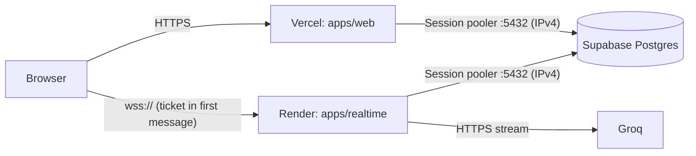

# Deploying Cue (free tiers)

| Part                 | Where                         | Notes                                                    |
| -------------------- | ----------------------------- | -------------------------------------------------------- |
| Web app (`apps/web`) | **Vercel**                    | Next.js. Sign-in, call library, replay page, `/latency`. |
| Realtime server      | **Render** web service (free) | Fastify + WebSockets. `render.yaml` in the repo root.    |
| Postgres             | **Supabase** (free)           | Through the **Session pooler**, never the direct host.   |
| Suggestions          | Groq                          | `GROQ_API_KEY` on Render only.                           |



You create the accounts and paste the secrets into each dashboard. Nothing secret goes into the repo.

## What the deployment contains (and what it doesn't)

- **Data: only the Apache-2.0 datasets.** That's gwenshap/sales-transcripts and DeepMostInnovations/saas-sales-conversations: `pnpm ingest -- --dataset licensed`.
- **No liva-ai/real-sales, ever.**
  - **Why:** it has no stated license, so there's no permission to show it to anyone else. A deployed app's GitHub sign-in is open to anyone with a GitHub account, so "behind sign-in" doesn't keep it private.
  - **Enforced:** `pnpm ingest` refuses to import it into any database that isn't on your machine. It stays local-only ([datasets.md](datasets.md)).
- **No audio.** Run ingest without `--with-audio`, and set `AUDIO_PLAYBACK=off` on Vercel. The audio route then always answers 404, and the replay page says "Audio not hosted in this deployment".
- **Optionally invite-only.** Set `ALLOWED_GITHUB_LOGINS=you,friend` on Vercel. Anyone else who signs in gets an "invite-only" page, and no Cue user is created for them. The check runs on every request, so removing a login takes effect at once.
- **Not indexed.** `robots.txt` disallows everything, and every response carries `X-Robots-Tag: noindex, nofollow`.

## 1. Supabase (database)

1. **Create a project** (free plan). Pick the region closest to your Render region.
2. **Copy the Session pooler string.** Go to **Connect** → **Connection string** → **Session pooler**. It looks like:

   ```
   postgresql://postgres.<project-id>:<password>@aws-0-<region>.pooler.supabase.com:5432/postgres
   ```

   Add `?sslmode=require` to the end.
   - The username is `postgres.<project-id>`, not plain `postgres`.
   - **Use this one string everywhere:** Vercel, Render, and your machine for migrations and ingest.

3. **Why not the direct connection** (`db.<project-id>.supabase.co`)? It's IPv6-only, and Render can't reach IPv6 addresses. The Session pooler is IPv4-compatible. Session mode also supports the prepared statements our driver uses, which the Transaction pooler (port 6543) doesn't.
4. **Connections are limited.** In session mode every client connection holds a Postgres connection, up to the project's pool size (shown under Database settings; often 15). So:
   - set `DATABASE_POOL_MAX=1` on Vercel, where each function instance has its own pool;
   - set `DATABASE_POOL_MAX=5` on Render (`render.yaml` does).
5. **Create the tables and load the data, from your machine** (PowerShell). Never do this from a build step:

   ```powershell
   $env:DATABASE_URL = '<the Session pooler string>'
   pnpm db:migrate
   pnpm ingest -- --dataset licensed
   Remove-Item Env:DATABASE_URL
   ```

   - `pnpm db:migrate` runs every pending migration on one connection, and is safe to repeat.
   - `--dataset licensed` imports gwenshap + saas only (300 saas calls by default).
   - Skip `pnpm db:seed`: its demo latency numbers are made up.

## 2. Render (realtime server)

1. **New → Blueprint**, then pick this repository. Render reads `render.yaml`:
   - a free web service;
   - build `corepack enable && pnpm install --frozen-lockfile`;
   - start `pnpm --filter @cue/realtime start`;
   - health check `/health`;
   - Node 20.19.
2. **Fill in the secrets Render asks for:**

   | Variable                   | Value                                                                |
   | -------------------------- | -------------------------------------------------------------------- |
   | `DATABASE_URL`             | the Session pooler string                                            |
   | `REALTIME_TICKET_SECRET`   | 32+ random characters; **the same value** as on Vercel               |
   | `REALTIME_ALLOWED_ORIGINS` | your Vercel production URL, e.g. `https://cue.vercel.app` (no slash) |
   | `GROQ_API_KEY`             | optional; without it, replays run without suggestions                |

3. **Note the service URL** (`https://<service>.onrender.com`). The browser connects to `wss://<service>.onrender.com`.

**Health endpoints:**

- **`GET /health`** never touches the database. Render's health check uses it, so a paused database can't trigger a restart loop.
- **`GET /health/ready`** checks the database too: `{"status":"ok","db":"ok","suggestions":"on"}`, or a 503 with `"db":"unreachable"`.

**Preview deployments:** each Vercel preview has its own URL, which isn't in `REALTIME_ALLOWED_ORIGINS`, so its WebSocket is refused with 403. Use the production URL. Wildcard origins aren't supported on purpose.

## 3. GitHub OAuth app (sign-in)

Create a **second** OAuth app for production at github.com/settings/developers. The local one keeps its localhost callback.

- **Homepage URL:** `https://<app>.vercel.app`
- **Authorization callback URL:** `https://<app>.vercel.app/api/auth/callback/github`

## 4. Vercel (web app)

1. **Import the repository**, set the root directory to **`apps/web`**, and keep the defaults: Vercel detects Next.js and pnpm, and installs the whole workspace. Pick Node.js 20.x or 22.x in Project Settings.
2. **Environment variables** (Production):

   | Variable                   | Value                                |
   | -------------------------- | ------------------------------------ |
   | `DATABASE_URL`             | the Session pooler string            |
   | `DATABASE_POOL_MAX`        | `1`                                  |
   | `AUTH_SECRET`              | `npx auth secret` (32+ characters)   |
   | `AUTH_GITHUB_ID`           | the production OAuth app's client id |
   | `AUTH_GITHUB_SECRET`       | its client secret                    |
   | `REALTIME_TICKET_SECRET`   | the same value as on Render          |
   | `NEXT_PUBLIC_REALTIME_URL` | `wss://<service>.onrender.com`       |
   | `AUDIO_PLAYBACK`           | `off`                                |
   | `ALLOWED_GITHUB_LOGINS`    | optional, e.g. `your-login,a-friend` |

3. **Redeploy after changing `NEXT_PUBLIC_REALTIME_URL`.** It's baked into the browser bundle at build time.

## Free-tier behaviour

**Render free web services spin down after 15 minutes without inbound traffic.**

- HTTP requests and WebSocket messages both count as traffic.
- The next request or connection wakes the service. That takes up to about a minute.
- While it wakes, the replay page shows "Waking the realtime server…", polls `/health` for up to 90 s, then connects.
- A spin-down or restart in the middle of a replay is survivable. Sessions stay `live`, the browser reconnects and resumes from the saved position, and only the 1-hour idle cleanup ends a session.
- Render discourages keep-alive pings to dodge the spin-down; this repo doesn't do that.

**Supabase pauses free projects after 7 days of low database activity.**

- A paused project refuses connections. `/health/ready` then reports `"db":"unreachable"`, and pages fail to load data.
- **Restore** it from the Supabase dashboard (the project page shows a Restore button). It takes a few minutes, and the data and settings are kept.
- Paused free projects can only be restored for a limited time (Supabase's docs have said 90 days and, elsewhere, 1 year), so check the dashboard rather than relying on either number.

**Vercel** doesn't sleep. A cold function start adds a little to the first request.

## Wake everything up (checklist)

Use this before a demo, or after a week or more of no use.

1. **Supabase.** Open the project in the Supabase dashboard. If it says **Paused**, click **Restore** and wait until it's healthy.
2. **Realtime + database.** Run:

   ```powershell
   pnpm wake -- --realtime wss://<service>.onrender.com --web https://<app>.vercel.app
   ```

   It polls `/health` for up to 2 minutes (a sleeping Render service takes about one), then checks `/health/ready` and the web app's sign-in page. It ends with "Everything is awake." (exit 0) or says what isn't. By hand:

   ```powershell
   curl.exe https://<service>.onrender.com/health/ready
   ```

   You want `"db":"ok"`. If you see `"db":"unreachable"`, go back to step 1.

3. **Web.** Open `https://<app>.vercel.app` and sign in with GitHub. If you see "invite-only", add your login to `ALLOWED_GITHUB_LOGINS`.
4. **A real replay.** Open a gwenshap call, pick a playbook, and replay it at 1×.
   - If a suggestion appears, everything works.
   - **No suggestion?** Check that `GROQ_API_KEY` is set on Render (`/health/ready` says `"suggestions":"on"`), and check your Groq quota.
5. **Connection refused?**
   - "origin not allowed" (403) means `REALTIME_ALLOWED_ORIGINS` doesn't match the exact URL in the address bar.
   - Close code 4401 means the two `REALTIME_TICKET_SECRET`s differ.

## Latency in the deployment

The browser, Vercel, Render, Supabase and Groq are now separate machines on the internet.

- Expect the deployed `/latency` numbers to be higher than local ones, mostly in time to first token (Render → Groq) and delivery (Render → browser).
- Saving each final to Supabase happens before it's sent, so `utterance_end` → `request_sent` includes a database round trip from Render to Supabase. That's why both should be in the same region.
- No suggestion timestamp includes Render's cold start: waking happens before a session exists.
